<a href="https://github.com/RejaulKorimSadi">
  <picture>
    <source media="(prefers-color-scheme: dark)" srcset="assets/hero-dark.svg">
    
  </picture>
</a>

 

I study why large language models state false things in the same confident tone they use for the truth. My B.Sc. thesis, *MRI of a Mad Machine: The Structural Origins of Hallucination*, traces those errors to three design choices inside the transformer and tests each one with pre-registered experiments, independent raters and open data. Alongside it, I am asking whether living neurons could one day hold part of a language model's context.

 

<picture>
  <source media="(prefers-color-scheme: dark)" srcset="assets/s1-dark.svg">
  
</picture>

<picture>
  <source media="(prefers-color-scheme: dark)" srcset="assets/mechanisms-dark.svg">
  
</picture>

  

<picture>
  <source media="(prefers-color-scheme: dark)" srcset="assets/s2-dark.svg">
  
</picture>

<a href="https://github.com/RejaulKorimSadi/P3-Commitment-Hallucination-Test"><picture><source media="(prefers-color-scheme: dark)" srcset="assets/ev-p3-dark.svg"></picture></a> <a href="https://github.com/RejaulKorimSadi/The-Attention-Ablation-Test"><picture><source media="(prefers-color-scheme: dark)" srcset="assets/ev-p5-dark.svg"></picture></a>

<a href="https://github.com/Taseen06/R2"><picture><source media="(prefers-color-scheme: dark)" srcset="assets/ev-r2-dark.svg"></picture></a> <a href="https://github.com/Taseen06/R3-LLM-Rating"><picture><source media="(prefers-color-scheme: dark)" srcset="assets/ev-r3-dark.svg"></picture></a>

 

<picture>
  <source media="(prefers-color-scheme: dark)" srcset="assets/s3-dark.svg">
  
</picture>

<a href="https://github.com/RejaulKorimSadi/Wetware-LLM-in-Silico">
  <picture>
    <source media="(prefers-color-scheme: dark)" srcset="assets/wetware-dark.svg">
    
  </picture>
</a>

  

<picture>
  <source media="(prefers-color-scheme: dark)" srcset="assets/s4-dark.svg">
  
</picture>

| | Paper | Status |
|:--|:--|:--|
| **R1** | **From Architecture to Output: Testing the Structural Origins of Hallucination and the Amplifying Role of Data** Sadi, Tasin, Naeem · [arXiv:2606.07537](https://arxiv.org/abs/2606.07537) · [code](https://github.com/RejaulKorimSadi/From_Architecture_to_Output_R1_Empirical_Evidence) | Under review, *Northern European Journal of Language Technology* |
| **R2** | **Wrong with Confidence: Measuring Hallucination, Overconfidence and Identity-Conditioned Behaviour in Large Language Models** Sadi, Tasin, Naeem, D. F. Chowdhury, H. A. A. Chowdhury · [pre-registration](https://doi.org/10.17605/OSF.IO/CS967) · [data](https://doi.org/10.5281/zenodo.20677241) · [code](https://github.com/Taseen06/R2) | Under review, *PeerJ Computer Science* |
| **R3** | **Characterising Divergence Between Heuristic and Language-Model Ratings of Mobile User Interface Quality** Sadi, Naeem, Tasin, Moosa, Emon, Rashid, Ahmed · [arXiv:2609.05423](https://arxiv.org/abs/2609.05423) · [code](https://github.com/Taseen06/R3-LLM-Rating) · earlier version presented at EFAST 2026 | Under review, *PeerJ Computer Science* |
| **AJSE** | **Behavioral Differences Between Active and Inactive Users in Competitive Programming: A Rating-Restricted Analysis of Codeforces Activity** Ruhan, Sadi, Rafi, D. F. Chowdhury, Opi, Mim, Naeem · [arXiv:2608.28618](https://arxiv.org/abs/2608.28618) | Accepted, *AIUB Journal of Science and Engineering* |
| **Preprint** | **The Cellular Data Center** Sadi, Ruhan, Chowdhury · [code](https://github.com/RejaulKorimSadi/Wetware-LLM-in-Silico) | In preparation |

 

<picture>
  <source media="(prefers-color-scheme: dark)" srcset="assets/s5-dark.svg">
  
</picture>

<picture>
  <source media="(prefers-color-scheme: dark)" srcset="assets/instruments-dark.svg">
  
</picture>

Outside research, I build applied AI systems: for IntelliGency Solutions (US) I designed a lead engine in which a language model drafts each message and a person approves it before it is sent.

 

<picture>
  <source media="(prefers-color-scheme: dark)" srcset="assets/s6-dark.svg">
  
</picture>

<picture><source media="(prefers-color-scheme: dark)" srcset="assets/stats-dark.svg">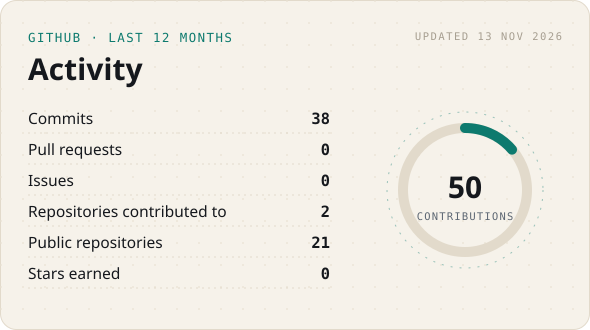</picture> <picture><source media="(prefers-color-scheme: dark)" srcset="assets/languages-dark.svg">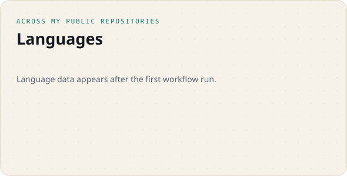</picture>

<picture>
  <source media="(prefers-color-scheme: dark)" srcset="https://raw.githubusercontent.com/RejaulKorimSadi/RejaulKorimSadi/output/snake-dark.svg">
  
</picture>

  

<a href="mailto:rejaulkorimsadi@gmail.com"><picture><source media="(prefers-color-scheme: dark)" srcset="assets/btn-email-dark.svg"></picture></a> <a href="https://www.linkedin.com/in/rejaulkorimsadi"><picture><source media="(prefers-color-scheme: dark)" srcset="assets/btn-linkedin-dark.svg"></picture></a>

<a href="https://orcid.org/0009-0004-1116-2985"><picture><source media="(prefers-color-scheme: dark)" srcset="assets/btn-orcid-dark.svg"></picture></a> <a href="https://arxiv.org/search/?searchtype=author&query=Rejaul+Korim+Sadi"><picture><source media="(prefers-color-scheme: dark)" srcset="assets/btn-arxiv-dark.svg"></picture></a>

<picture>
  <source media="(prefers-color-scheme: dark)" srcset="assets/footer-dark.svg">
  
</picture>
