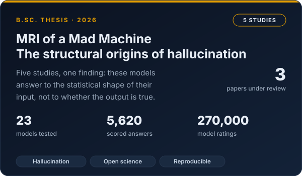
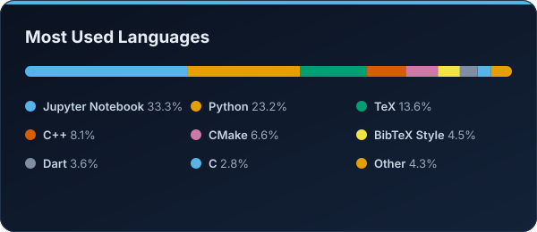
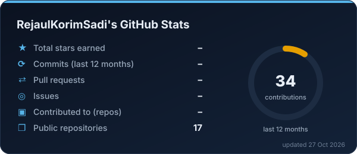
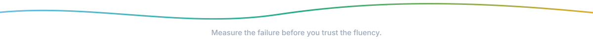

  

  
  
  
  

### About

I'm a final-year B.Sc. student in Computer Science and Engineering at Metropolitan University, Sylhet, Bangladesh. My research asks why large language models state false things in the same confident tone they use for the truth. I trace those errors to specific parts of the architecture, then test each claim with controlled, pre-registered experiments and publish the data and code.

- **Working on:** my B.Sc. thesis, *MRI of a Mad Machine: The Structural Origins of Hallucination*
- **Methods:** architecture ablations, matched model pairs, blind double-scoring, mixed-effects models
- **Looking for:** MSc research positions in NLP and trustworthy AI for 2027

### Research

  
  

  
  

  
  

### Publications

| Paper | Status |
| --- | --- |
| **From Architecture to Output: Testing the Structural Origins of Hallucination and the Amplifying Role of Data** Sadi, Tasin, Naeem | Under review, NEJLT · [SSRN preprint](https://papers.ssrn.com/sol3/papers.cfm?abstract_id=6604798) |
| **Wrong with Confidence: Measuring Hallucination, Overconfidence and Identity-Conditioned Behaviour in Large Language Models** Sadi, Tasin, Naeem, D. F. Chowdhury, H. A. A. Chowdhury | Under review · [pre-registration](https://osf.io/a9rvz) |
| **Characterising Divergence Between Heuristic and Language-Model Ratings of Mobile User Interface Quality** Sadi, Naeem, Tasin, Moosa, Emon, Rashid, Ahmed | Under review, PeerJ Computer Science |
| **Predicting Student Attrition in Competitive Programming** Co-author | Accepted, AIUB Journal of Science and Engineering (2026) |
| **MRI of a Mad Machine: The Structural Origins of Hallucination** B.Sc. thesis, with T. R. Tasin and D. F. Chowdhury; supervised by G. M. Naeem | 2026 |

### Toolbox

  
  
  
  
  
  
  
  
  
  
  
  

### Activity

  
  

  <picture>
    <source media="(prefers-color-scheme: dark)" srcset="https://raw.githubusercontent.com/RejaulKorimSadi/RejaulKorimSadi/output/snake-dark.svg">
    <source media="(prefers-color-scheme: light)" srcset="https://raw.githubusercontent.com/RejaulKorimSadi/RejaulKorimSadi/output/snake-light.svg">
    
  </picture>

### Reach me at

  
  
  

Open to research collaboration on hallucination, uncertainty and LLM evaluation.

